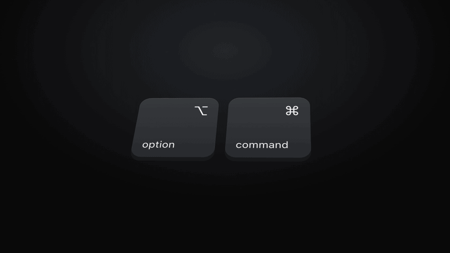
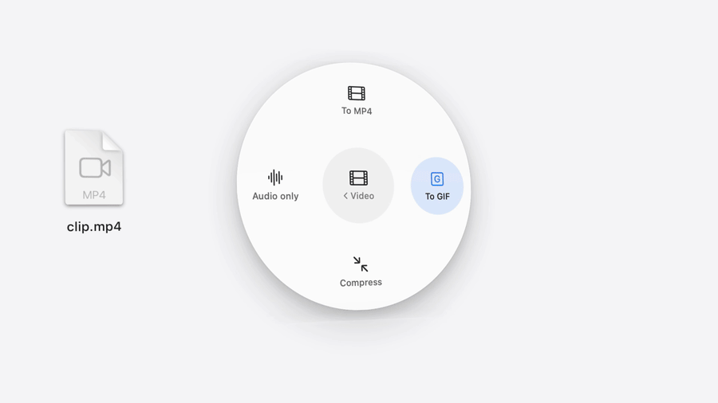
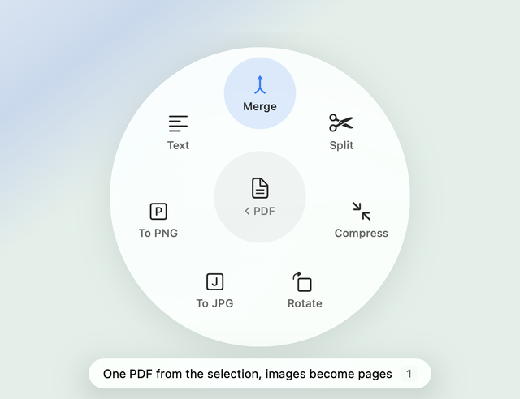
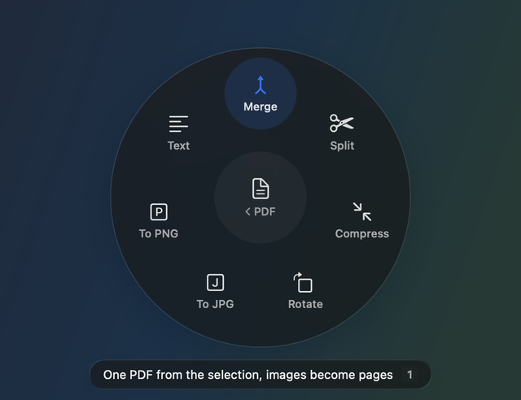

<p align="center">
  
</p>

<h1 align="center">Dial</h1>

<p align="center">
  <b>Quick file actions for macOS Finder.</b><br>
  Tap ⌥ ⌘ to convert, merge and compress files without opening an app.
</p>

<p align="center">
  <a href="https://github.com/Rythme19/Dial/releases/latest"></a>
  <a href="https://github.com/Rythme19/Dial/releases"></a>
  
  
  
  <a href="LICENSE"></a>
</p>

<p align="center">
  <a href="#install"><b>Install</b></a> ·
  <a href="#keys">Keys</a> ·
  <a href="#build-from-source">Build from source</a> ·
  <a href="https://github.com/Rythme19/Dial/releases/latest">Download</a>
</p>

<br>

Select files in Finder, tap **⌥ Option + ⌘ Command**, and a small
Liquid Glass ring opens under the pointer. Pick a type, then an action. The result lands
next to the original, and Dial never overwrites anything (it adds " 2" instead).
Everything runs locally.

<p align="center">
  
</p>

| Type | Actions |
|---|---|
| PDF | Merge (PDFs and images), Split, Compress, Rotate, To JPG, To PNG, Text |
| Image | To JPG, To PNG, To PDF, To WebP, Half size, Compress, Strip info |
| Video | To MP4, To GIF, Compress, Audio only |
| Audio | To MP3, To M4A, To WAV |
| General | Zip, Copy path, New folder, Add date |

With a mixed selection (for example a PDF and an MP4), the ring only shows what works.

<p align="center">
  
</p>

<p align="center">
  
  
</p>

## Keys

- **⌥ Option + ⌘ Command**: tap and release to open or close the ring (Finder must be in front).
  To use other keys, open **Settings…** from Dial's menu-bar icon and pick any two or more of
  fn, Control, Option, Command and Shift.
- **1–9** or click: choose an item.
- **← →**: move. **Return**: choose.
- **Esc**, or a click in the centre: go back or close.

## Install

Paste this into Terminal (Applications → Utilities → Terminal) and press Return:

```bash
curl -fsSL https://raw.githubusercontent.com/Rythme19/Dial/main/install.sh | bash
```

It puts Dial in the Applications folder inside your home folder (or updates the copy in
/Applications, if you put one there) and starts it. Run the same line again to update.
It needs macOS 26 on a Mac with Apple silicon.

Then allow two things, once:

- **Accessibility**, to notice your shortcut: System Settings → Privacy & Security → Accessibility → turn on Dial.
- **Finder**, to read which files are selected: click **Allow** the first time Dial asks.

PDF Compress, To WebP and the video and audio actions use free tools (Ghostscript, WebP and ffmpeg).
If you have [Homebrew](https://brew.sh), the installer offers to add them. Otherwise run
`brew install ghostscript ffmpeg webp` later.

### Without Terminal

Download `Dial.zip` from [Releases](https://github.com/Rythme19/Dial/releases/latest), unzip it and move
Dial to Applications. Dial isn't notarized by Apple, so macOS blocks it the first time:

1. Open Dial and click **Done** in the warning.
2. Go to System Settings → Privacy & Security, scroll down and click **Open Anyway** next to Dial.
3. Confirm with **Open Anyway** and your password.

### Updates

Each version has a new signature, so macOS asks for the two permissions again after an update.
The installer clears the old ones for you. If you updated by hand and the shortcut does nothing,
remove Dial from the Accessibility list with **−** and turn it on again.

## Build from source

Needs the Command Line Tools (`xcode-select --install`).

```bash
./build.sh            # → build/Dial.app
./build.sh install    # also copies it to ~/Applications and restarts it
./build.sh release    # also zips it to build/Dial.zip, to attach to a GitHub release
```

A build you make yourself is never blocked by macOS.

## Develop

```bash
build/Dial.app/Contents/MacOS/Dial --selftest <folder of sample files>
```

The self-test checks the shortcut detection and the mixed-selection rules, then runs every action
on temporary copies.

`--demo [--dark] [--level PDF] [--hot N] [--press N] files…` shows the ring in a fixed
state for screenshots. `design/radial-preview.html` is the HTML mock it was designed from.

```
Sources/Actions.swift     file kinds, the action catalog, conversion engines
Sources/RadialMenu.swift  menu model and the SwiftUI ring
Sources/main.swift        menu-bar app, shortcut detection and Settings, Finder selection, self-test
design/icon.swift         draws AppIcon.icns (swift design/icon.swift)
design/social.swift       draws docs/logo.png and docs/social-preview.png from it
```

## License

MIT. See [LICENSE](LICENSE).
